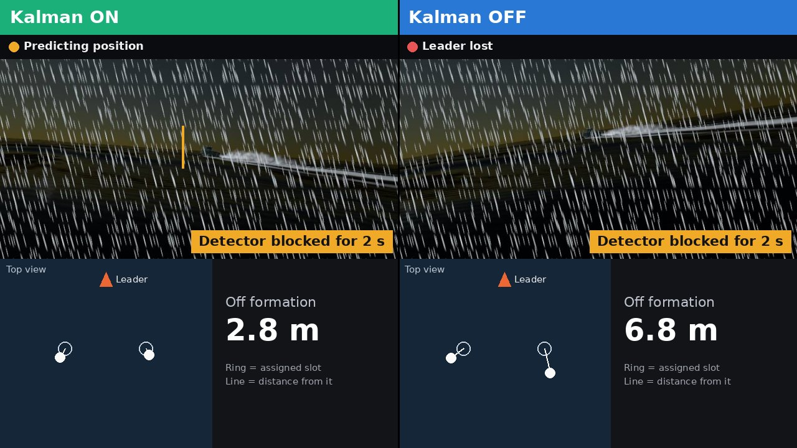
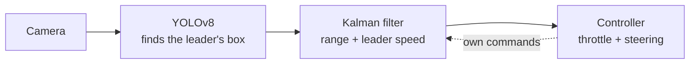
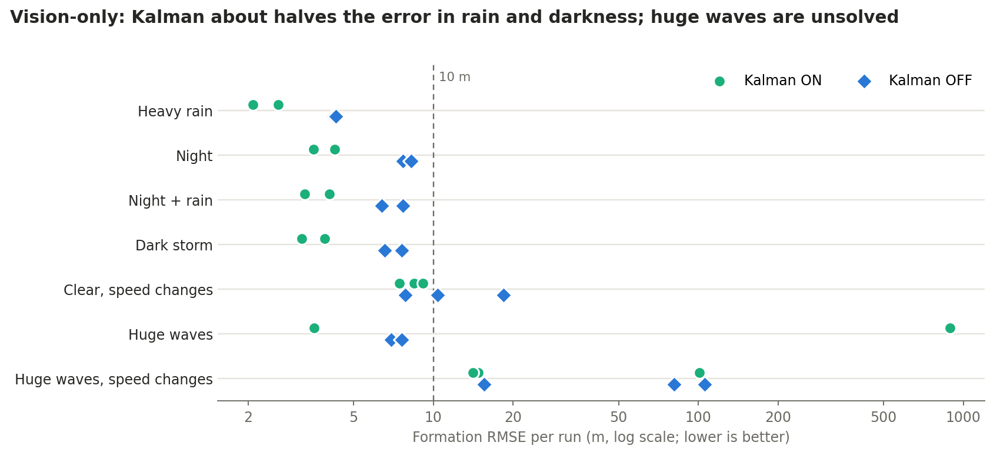
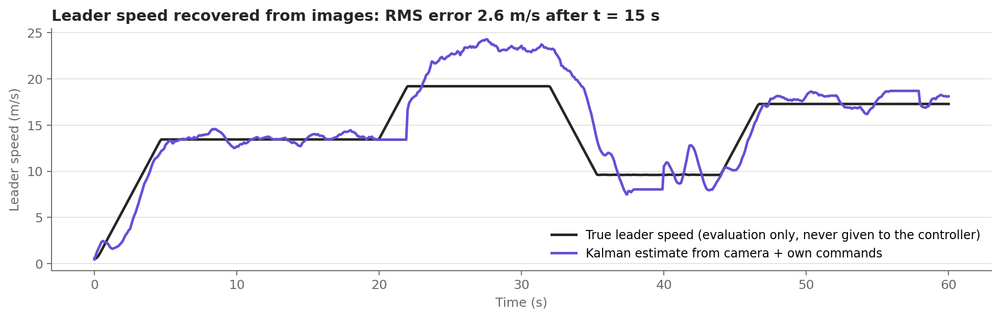

# Vision-Only USV Fleet Formation in Unity

A simulated three-boat fleet. Two follower boats hold a triangle formation behind a leader using only a forward camera and a Kalman
filter, with no leader speed, speed sensor, heading or GPS position. This repo holds the Unity simulation (waves, wakes, rain, fog,
night), the Python controller, the detector dataset tools, and the experiments behind the results below.

> **Pattern Recognition course project (this branch).** The camera tracker's hand-tuned noise settings are replaced by a
> maximum-likelihood estimate (course Ch. 3-1). It is compared with raw YOLO and the hand-tuned tracker on the USV (64 sequences,
> plus 30 in pre-registered extreme waves) and on drone videos. The learned tracker beats the hand-tuned one in every condition,
> beats YOLO in clear water, rain and night, and loses to YOLO in the dark storm.
> Charts, statistics and detection clips: **[Documentation/PR_Course/README.md](Documentation/PR_Course/README.md)**.
>
> 



*The same dark storm lap at the moment the detector is blocked for a test: Kalman ON keeps predicting, and Kalman OFF has lost the leader.*



> **Simulation only.** Nothing has been run on a real boat. The control loop runs at a fixed 10 Hz with zero processing
> delay. Hulls use thrust, steering torque, drag and wave-driven heave, pitch and roll. There are no full ship
> hydrodynamics, wind or currents, and the leader follows its path perfectly.

> **What runs where.** The vision-only tracker lives in the test harness, `Tools/kalman_study`. It is not integrated into `Assets/usv`
> yet, so `python usv_controller.py` still uses the original controller, the leader's speed, and `best_realistic.pt` by default
> (`YOLO_MODEL_PATH` in `Assets/usv/config.py`).

## Results

All numbers are formation RMSE: the root mean square distance of each follower from its slot, from t = 15 s to the end of
the run. "Broken" means error above 10 m.

**Vision-only tracking, Kalman ON vs OFF.** Followers use only the camera and their own throttle commands: no leader speed, no
speed sensor, no heading. Mean of 2 seeds per lap; recovery is the time back in formation after a 2 s bbox dropout.

| Full circle lap | RMSE, Kalman | RMSE, Kalman OFF | Recovery, Kalman | Recovery, Kalman OFF |
|---|---:|---:|---:|---:|
| Heavy rain | **2.34 m** | 4.24 m | 0.9 s | 1.8 s |
| Night | **3.89 m** | 7.96 m | 0.9 s | 4.1 s |
| Night + rain | **3.66 m** | 7.03 m | 0.9 s | 5.2 s |
| Dark storm | **3.53 m** | 7.07 m | 1.2 s | 5.0 s |



Huge waves are still the weak point: on a full lap, one of two Kalman runs lost the leader for good after a dropout (891 m; the other
3.55 m), while Kalman OFF held both at about 7 m. With speed changes added, median error is 14.73 m for Kalman and 80.91 m for Kalman OFF,
with far-out-of-formation runs in both. In clear water with speed changes, it is 8.46 m vs 10.39 m. These are 2-3 seeds per case.

### Earlier results, with the leader's true speed available

**Kalman filter vs baselines** (8 held-out seeds; clear water, huge waves and rain):

| Comparison | RMSE change | Seeds favouring Kalman | Exact p |
|---|---:|---:|---:|
| Kalman vs no filter (same controller) | -68.8% | 8/8 | 0.0078 |
| Kalman vs production Kalman OFF | -48.9% | 8/8 | 0.0078 |
| Kalman vs EMA filter (same controller) | -33.2% | 6/8 | 0.078, not confirmed |

An earlier image-space Kalman filter did not beat its baseline on held-out seeds. Both results are in
[FINAL_REPORT.md](Documentation/KalmanStudy/FINAL_REPORT.md).

**Weather-trained detector** (`best_realistic_v2.pt`, full circle laps, mean of 2 seeds). The original detector found the leader
in 0-3% of frames in these conditions and every method failed. With the retrained detector the Kalman filter gets a fresh detection
in about 88% of frames, close to the maximum because scheduled 2 s dropouts remove about 11%.

| Condition | Kalman filter | Kalman OFF | No bbox filtering |
|---|---:|---:|---:|
| Heavy rain | **2.73 m** | 5.62 m | 4.97 m |
| Night | **3.79 m** | 7.06 m | 301.74 m (1 of 2 seeds lost) |
| Night + rain | **3.71 m** | 7.00 m | 6.26 m |
| Dark storm | **3.31 m** | 6.14 m | 5.59 m |

After each 2 s dropout the Kalman filter is back in formation in 0.9 s, Kalman OFF in about 6 s, and no filtering in 7.5-9 s. The
detector was trained and tested on the same simulated weather, so this says nothing about real rain or night cameras.
Long, tight turns (radius about 164 m) still break formation for every method, even with detection working.
Details: [weather_v2_detector](Documentation/KalmanStudy/REPORT_PACKAGE/weather_v2_detector/README.md).

**What leader speed adds.** All results in this section, including Kalman OFF, receive the leader's true speed from the simulator, so
they are not vision-only. Simply deleting it from that controller makes the formation collapse, which is why the vision-only filter
estimates it instead. Comparison with that filter (median of 3 seeds, broken time in brackets):

| Condition | With leader speed | Camera + own speed | Camera + own commands only |
|---|---:|---:|---:|
| Calm, constant speed | 2.90 m (0%) | **1.45 m** (0%) | 2.22 m (0%) |
| Clear, speed changes + S-turns | **5.15 m** (1.4%) | 7.85 m (25.8%) | 8.48 m (26.3%) |
| Night, speed changes + S-turns | **5.69 m** (2.0%) | 6.65 m (14.5%) | 6.47 m (12.2%) |
| Huge waves, speed changes + S-turns | **5.42 m** (4.5%) | 12.26 m (49.8%) | 13.94 m (39.3%) |

So the fleet can track without leader speed, and does better at constant speed, but it loses accuracy when the leader changes
speed and is weakest in huge waves, where one of three "camera + own speed" seeds lost the formation.
Details: [vision_only](Documentation/KalmanStudy/REPORT_PACKAGE/vision_only/README.md).



Videos are not stored in this repo because of their size.

# Python Setup

Create the Conda environment:

```bash
conda env create -f environment.yml
conda activate unity_boat
```

Or install with pip only:

```bash
pip install -r requirements.txt
```

# Usage

Run Controller(Keyboard or Trajectory following)

```bash
cd Assets
python usv_controller.py
```

> **Note**
> 
> User can set Control mode to Keyboard or Trajectory following mode in config.py
> 
> By setting ```LEADER_INITIAL_CONTROL_MODE = "Trajectory"``` or ```LEADER_INITIAL_CONTROL_MODE = "Keyboard"``` to switch control mode.
> 
> Set trajectory mode: ```LEADER_TRAJECTORY_MODE = "Circle"``` or ```LEADER_TRAJECTORY_MODE = "Straight"```
## Run evaluation matrices

```
python usv/plot_snapshots.py --snapshot ../experiment_metrics/run_20260531_113548_snapshots.csv
```

# Run the Kalman study

The study uses a frozen Unity build and a private copy of the Python code for each run, so it does not touch `Assets/usv`.
Build the player once, which needs Unity 2022.3.62f3 installed:

```bash
cd Tools/kalman_study
python3 run_study.py --build-only
```

Re-run the with/without leader speed test, using one process per parallel simulator (`--shard 0` to `7`), then analyze it:

```bash
python3 run_vision_only.py --stage evaluation --tag e06_vision_only \
  --protocol ../../Documentation/KalmanStudy/eval_e06_vision_only_protocol.json --shard 0 --nshards 8
python3 analyze_arms.py ../../Experiments/KalmanStudy/robust_evaluation/e06_vision_only
python make_vision_only_report.py
```

Raw run data goes to `Experiments/KalmanStudy/`, which is not committed. Protocols, reports and figures are in
`Documentation/KalmanStudy/`. Dataset generation and detector training are described in
[Tools/boat_dataset/README.md](Tools/boat_dataset/README.md).

# Codebase

## USV Controller (Modular Split)

Callable functions for usv_controller.py 

Modules
-------
- `config.py`: all tunable constants and ports.
- `state.py`: shared runtime state and thread locks.
- `helpers.py`: common utility helpers and drawing helpers.
- `vision.py`: TCP camera receive + YOLO/depth/wake processing thread.
- `control.py`: vision-based control logic and command output.
- `app.py`: startup wiring, main loop, and UI loop.

-------
```text
usv_controller.py
└── calls usv.app.main()

usv/
├── __init__.py
│   └── exports main
│
├── app.py
│   ├── creates UDP sockets
│   ├── creates OpenCV windows
│   ├── starts TCP camera receiver threads
│   ├── starts central vision processing thread
│   ├── runs main control loop
│   ├── calls process_boat_vision_based() for Left boat
│   ├── calls process_boat_vision_based() for Right boat
│   └── displays processed frames
│
├── config.py
│   ├── UDP / TCP port settings
│   ├── camera stream configuration
│   ├── YOLO model settings
│   ├── wake detection parameters
│   ├── tracking / prediction parameters
│   └── controller parameters
│
├── state.py
│   ├── vision_lock
│   ├── frame_lock
│   ├── vision_states
│   ├── latest_frames
│   ├── display_frames
│   ├── formation_targets
│   └── controller_states
│
├── vision.py
│   ├── tcp_camera_receiver_thread()
│   ├── cv_processing_thread()
│   ├── detect_stern_wake()
│   ├── fuse_track_sources()
│   ├── lock_visual_reference()
│   ├── update_track_prediction()
│   ├── configure_yolo_runtime()
│   └── warmup_yolo_runtime()
│
├── control.py
│   ├── process_boat_vision_based()
│   ├── compute_pair_catchup_boost()
│   ├── get_tracking_gains()
│   ├── normalize_area_error()
│   ├── shape_area_error()
│   ├── compute_centered_cruise_throttle()
│   ├── compute_turn_catchup_boost()
│   └── compute_visual_far_boost()
│
└── helpers.py
    ├── recv_exact()
    ├── make_status_frame()
    ├── clamp()
    ├── blend_value()
    ├── get_peer_boat_side()
    ├── filter_steer_command()
    ├── draw_labeled_box()
    ├── draw_prediction_arrow()
    └── apply_camera_shake()
```

Entrypoint
----------
- Run `Assets/usv_controller.py`.


# Setup and push
Setup once

```
sudo apt install git-lfs
git lfs install
```

Track large files

```
git lfs track "*.zip"
git lfs track "*.pt"
git lfs track "*.mp4"
```

Add files
```
git add .gitattributes

git add .
```

Commit and push
```
git commit -m "message"

git push origin main
```
 


