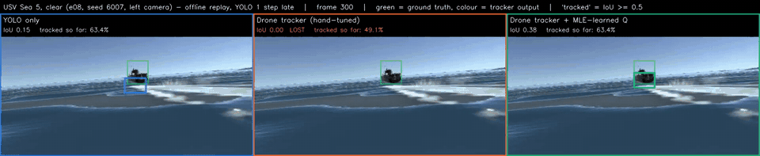
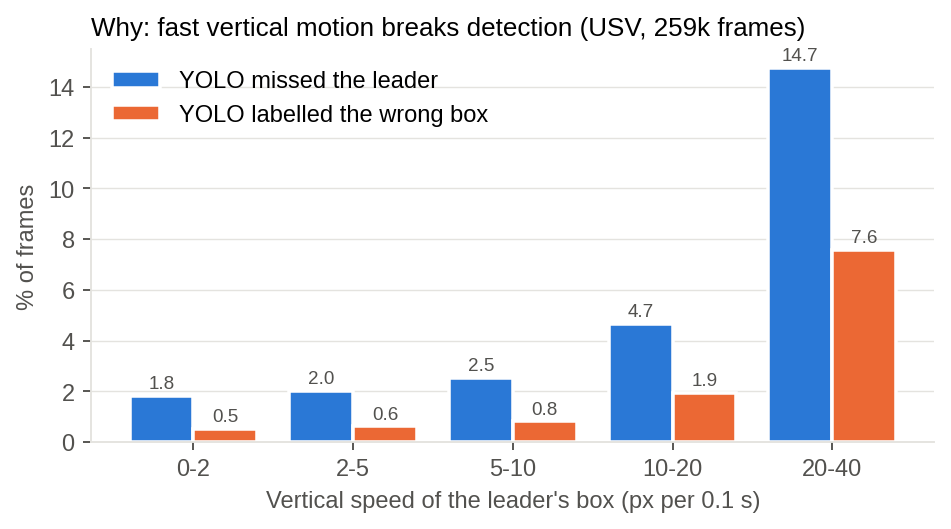
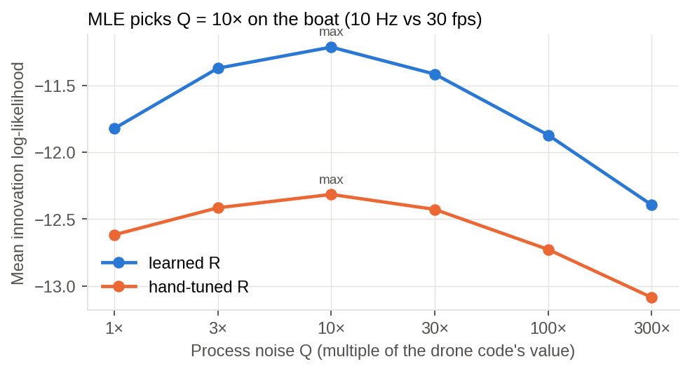
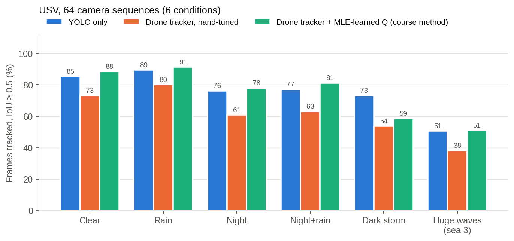
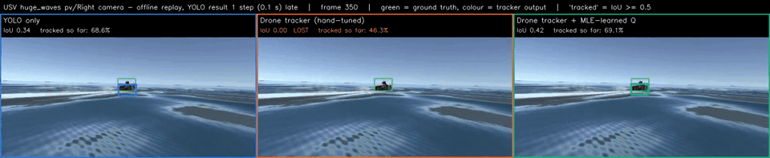
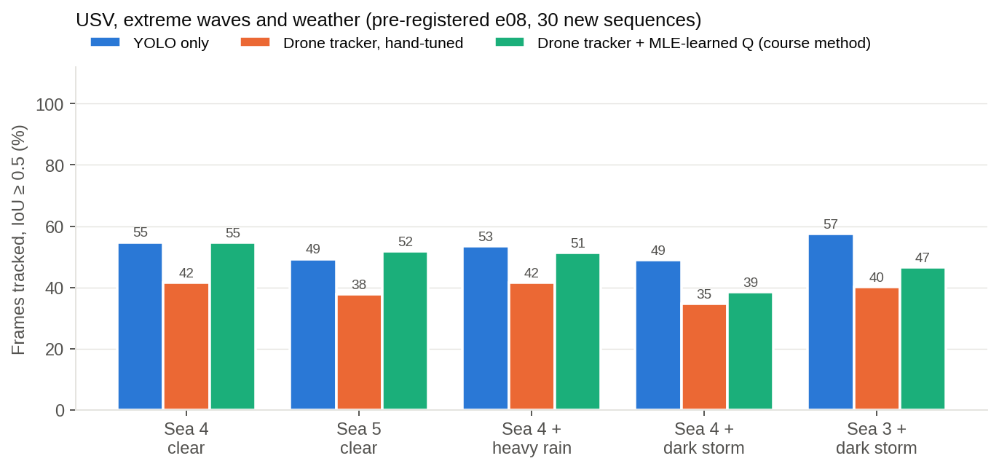
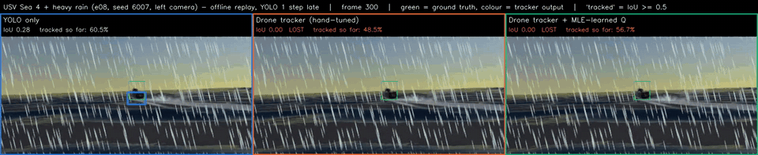
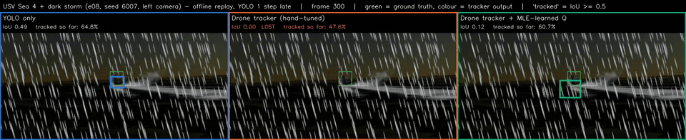
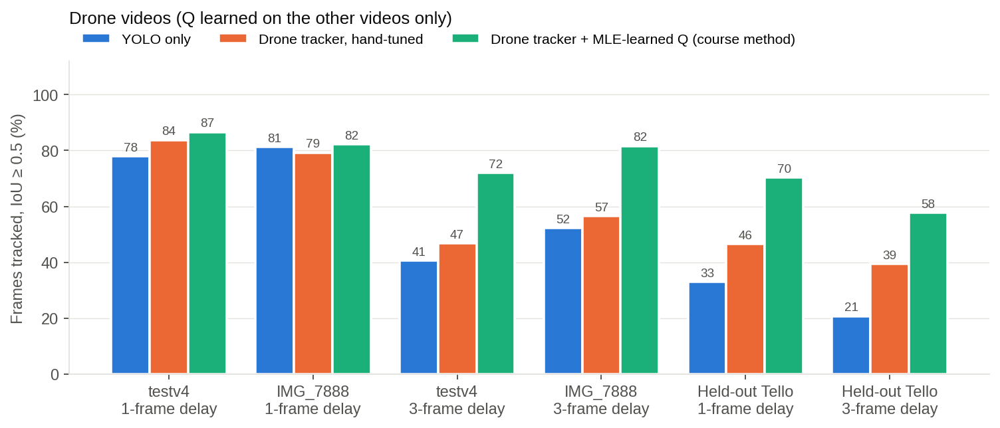
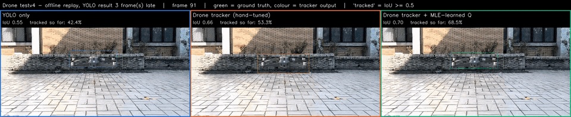

# Pattern Recognition Course Project: Learning a Camera Tracker from Data

> This branch holds the **Pattern Recognition course final project**. The original USV formation project README is on the
> [`main` branch](https://github.com/StanleyChueh/Unity_Ship_Formation_Study/blob/main/README.md).

Our group tracks one target with a camera on two platforms using the same pipeline: **YOLOv8 → Lucas-Kanade optical flow → Kalman
filter**. One member tracks a flying drone; the other tracks the leader boat of a simulated unmanned surface vessel (USV) fleet that
keeps formation using only a camera. Both fail when the target's box moves up and down quickly in the image: the drone climbs and
drops, and the boat's camera pitches in waves.

The drone tracker works on drone video, but its key settings were tuned by hand: process noise Q, measurement noise
R = 60·(0.5/confidence)², and a gate that decides which box is the target. **This project replaces those hand-tuned constants with
methods from the course** and compares three trackers against ground truth on both platforms:

| Tracker | What it is |
|---|---|
| **YOLO only** | The newest YOLO box, used as is |
| **Drone tracker, hand-tuned** | The teammate's `track.py` with its constants unchanged |
| **Drone tracker + MLE-learned Q** | The same tracker, with Q estimated by maximum likelihood from training data (course method) |



*USV in sea state 5 (waves about 3.9 m). Green is the simulator's true box. The hand-tuned box (middle) is lost; the learned-Q box
(right) stays on the leader.*

## Methods from the course

| Course chapter | Used for |
|---|---|
| Ch. 3-1 Maximum-likelihood estimation | **Process noise Q** (main method) and measurement noise R |
| Ch. 2 Bayesian decision theory | Minimum-risk rule to accept or reject each detected box |
| Ch. 1 Design cycle, ROC | Labelled data, train/test split, evaluation against ground truth |
| Ch. 3-2 PCA, Fisher LDA; Hughes effect | Feature analysis (planned for the final presentation) |

**Maximum-likelihood Q.** For a correct filter model, the innovations ν<sub>k</sub> (each measurement minus the filter's prediction)
are independent Gaussian, ν<sub>k</sub> ~ N(0, S<sub>k</sub>). We choose the Q that makes the observed innovations most likely:

$$\hat{Q} = \arg\max_Q \sum_k \ln \mathcal{N}\big(\nu_k;\, 0,\, S_k(Q)\big), \qquad S_k = H P_{k|k-1} H^\top + R$$

This is the Ch. 3-1 principle (choose θ to maximise p(D | θ)) with the innovations as the samples. Because S<sub>k</sub> depends on Q
through the filter's recursion, we maximise over a grid. Q is always learned on training data that excludes the test sequences.

**Minimum-risk Bayes rule.** Accept a box when

$$\frac{p(x\mid\omega_1)}{p(x\mid\omega_2)} > \frac{\lambda_{12}-\lambda_{22}}{\lambda_{21}-\lambda_{11}}\cdot\frac{P(\omega_2)}{P(\omega_1)}$$

where ω<sub>1</sub> is the target, and accepting a false box (λ<sub>12</sub>) costs more than rejecting a true one (λ<sub>21</sub>).

## Why this matters: fast vertical motion breaks detection



On the USV, missed detections rise from 1.8% to 14.7%, and wrong boxes from 0.5% to 7.6%, as the box moves faster vertically.

## Result 1: maximum likelihood finds the right Q for each platform



On the boat, the likelihood peaks at **10× the drone setting** in both training folds. That matches the frame rates: the boat camera
runs at 10 Hz and the drone video at 30 fps, so the box moves about 3× as far per step, and the variance is about 9× larger. The
hand-tuned value was right for the drone and wrong for the boat; maximum likelihood finds the right one from data.

## Result 2: USV, 64 camera sequences in 6 conditions



| Condition | YOLO only | Hand-tuned | **Learned Q** | Learned Q better than hand-tuned | Learned Q vs YOLO only |
|---|---:|---:|---:|---|---|
| Clear | 85.3% | 73.2% | **88.4%** | 12/12 sequences | better, 11/12 (p = 0.001) |
| Rain | 89.3% | 80.1% | **91.3%** | 8/8 | better, 7/8 (p = 0.016) |
| Night | 76.1% | 60.7% | **77.8%** | 8/8 | better, 6/8 (p = 0.078) |
| Night + rain | 77.1% | 63.1% | **81.1%** | 8/8 | better, 8/8 (p = 0.008) |
| Dark storm | **73.2%** | 53.7% | 58.5% | 8/8 | **worse**, 0/8 (p = 0.008) |
| Huge waves (sea 3) | 50.6% | 38.2% | **51.1%** | 20/20 | tie (p = 0.7) |
| **All** | | | | **64/64 (p = 4×10⁻¹²)** | 42/64 (p = 0.11) |

Percentages are the share of frames whose box overlaps the true box with IoU ≥ 0.5, pooled over each condition's sequences. The
"better than" counts are per sequence, with p from a two-sided Wilcoxon signed-rank test. YOLO results reach the tracker one control
step (0.1 s) late, for all three trackers.



## Result 3: USV, extreme waves and weather (pre-registered)

We then ran 15 new simulations (30 camera sequences) with waves larger than anything run before: sea 4 is about 3.1 m and sea 5 about
3.9 m. The conditions, seeds, analysis and video-selection rule were fixed in
[`eval_e08_extreme_waves_protocol.json`](Documentation/PR_Course/eval_e08_extreme_waves_protocol.json) before any run. Q was **not** refitted: it is the 10×
learned from the earlier runs.



| Case | YOLO only | Hand-tuned | Learned Q | Learned Q better than hand-tuned | Learned Q vs YOLO only |
|---|---:|---:|---:|---|---|
| Sea 4, clear | **54.7%** | 41.6% | 54.6% | 5/6 | tie (3/6, p = 1) |
| Sea 5, clear | 49.3% | 37.7% | **51.8%** | 6/6 | slightly better (5/6, p = 0.094) |
| Sea 4 + heavy rain | **53.5%** | 41.6% | 51.3% | 6/6 | slightly worse (1/6, p = 0.22) |
| Sea 4 + dark storm | **48.9%** | 34.7% | 38.5% | 5/6 | worse (0/6, p = 0.031) |
| Sea 3 + dark storm | **57.4%** | 40.1% | 46.5% | 6/6 | worse (0/6, p = 0.031) |
| **All** | 52.7% | 39.1% | 48.4% | **28/30 (p = 3.5×10⁻⁶)** | worse overall (9/30, p = 0.006) |

| Sea 4 + heavy rain: YOLO slightly ahead of learned Q, both far ahead of hand-tuned | Sea 4 + dark storm: the limit case |
|---|---|
|  |  |

## Result 4: drone videos

The drone ground truth comes from Grounding DINO (2 prompts × horizontal flip), fused with the teammate's own labelling rule. YOLO is
**not** one of the opinions, so the labels are independent of the model being tested, and they were checked by eye
([audit sheets](Documentation/PR_Course/results/drone)). Q is learned on one video and tested on the other. The Tello video is a different drone in a
different (indoor) scene, never used for training or for choosing Q.



| Test video | YOLO only | Hand-tuned | Learned Q | Learned Q − hand-tuned, points [95% CI] |
|---|---:|---:|---:|---|
| testv4, 1-frame delay | 77.9% | 83.8% | **86.6%** | +2.9 [−1.2, +7.3] |
| IMG_7888, 1-frame delay | 81.3% | 79.2% | **82.2%** | +3.0 [+1.1, +5.1] |
| testv4, 3-frame delay | 40.6% | 46.8% | **71.9%** | +25.2 [+13.3, +35.5] |
| IMG_7888, 3-frame delay | 52.3% | 56.5% | **81.6%** | +25.1 [+16.2, +35.9] |
| Held-out Tello, 1-frame delay | 33.0% | 46.5% | **70.3%** | +23.9 [+9.0, +43.3] |
| Held-out Tello, 3-frame delay | 20.8% | 39.4% | **57.8%** | +18.3 [+2.3, +34.7] |

Confidence intervals come from resampling 1-second blocks of frames (block bootstrap). A 1-frame delay is the teammate's real setup
(YOLO takes 11 ms per frame; a frame lasts 33 ms); a 3-frame delay imitates a slower onboard computer.



## What the results show

1. **Hand-tuned constants do not transfer between platforms.** The drone tracker is worse than raw YOLO on the boat in every condition.
2. **The MLE-learned Q beats the hand-tuned tracker in every condition we tested.** It wins on 64/64 normal boat sequences and 28/30
   extreme ones. On the drone it is higher in all 6 cases (+3 to +25 points), and the 95% interval excludes zero in 5 of them.
3. **Against raw YOLO it is a trade-off.** The learned tracker beats YOLO in clear water, rain, night and night + rain, and on the
   drone whenever detections are late or missing. It ties YOLO in huge waves. In heavy rain with huge waves YOLO is slightly
   ahead, and **in the dark storm YOLO is clearly better (by about 10 to 15 points)**. A filter predicts motion; when detections are
   sparse and the camera pitches unpredictably, a fresh detection beats a prediction. Learning a separate Q for each sea condition,
   chosen by a Bayes/LDA condition classifier, is the next step.
4. **Other course methods gave mixed results.** The MLE-learned R and the Bayes gate help on the drone with its real delay (the gate
   reaches 96% in testv4's fastest frames and halves wrong-target frames on IMG_7888). They hurt on the boat, where wrong boxes are
   rare and rejecting true ones makes the tracker drift.

**Limitations.** These are offline replays of recorded frames, not closed-loop runs, and the USV is simulation only. The drone ground
truth is automatic, from two training videos plus one held-out video. In sea state 5 the camera sometimes dips below the wave
surface (a grey band). On the held-out Tello video with a 3-frame delay, the Q search chose the edge of its range (1000×), so that
value is unreliable.

## Files

| Path | Contents |
|---|---|
| [`PR_Final_Project_Proposal_and_Method.pdf`](Documentation/PR_Course/PR_Final_Project_Proposal_and_Method.pdf) | Full proposal, method and results report (10 pages) |
| [`Midterm_Q1_Answer.pdf`](Documentation/PR_Course/Midterm_Q1_Answer.pdf), [`Midterm_Q1_Answer_zh-TW.pdf`](Documentation/PR_Course/Midterm_Q1_Answer_zh-TW.pdf) | Midterm Question 1 answer (English and Traditional Chinese) |
| [`eval_e08_extreme_waves_protocol.json`](Documentation/PR_Course/eval_e08_extreme_waves_protocol.json) | Pre-registered extreme-wave protocol |
| [`results/`](Documentation/PR_Course/results) | Result JSONs, logs, drone labels, YOLO outputs, ground-truth audit sheets |
| [`media/`](Documentation/PR_Course/media) | Charts and GIF clips on this page |
| [`../../Tools/pr_course/`](Tools/pr_course) | Tracker replay, labelling, analysis, video rendering, report builders |

**Full-length videos** are not committed (the repo ignores `*.mp4`). They are written to `Experiments/PR_Course/rollouts/`:
`HIGHLIGHT_learnedQ_vs_handtuned.mp4`, `drone_*_delay{1,3}.mp4`, `usv_*.mp4` and `usv_e08_*.mp4`. Each has three panels (YOLO only,
hand-tuned, learned Q), the true box in green, the live IoU and the running share of well-tracked frames.

## Reproduce

```bash
cd Tools/pr_course
python usv_replay.py ../../Experiments/PR_Course/usv/usv_report.json        # USV: learn R and Q per fold, all trackers
python drone/analyze.py ../../Experiments/PR_Course/drone                    # drone: cross-video training and testing
python rollouts.py ../../Experiments/PR_Course/rollouts                      # statistics and full-length videos
python new_video_eval.py img7923 ../../Experiments/PR_Course/rollouts        # held-out Tello video
python e08_eval.py ../../Experiments/PR_Course/rollouts                      # extreme-wave analysis
python report/make_readme_media.py ../../Documentation/PR_Course/media       # charts and GIFs on this page
```

The extreme-wave simulations use the frozen simulator build (`Tools/kalman_study/run_extreme_waves.py`, three shards). Drone inputs
(the teammate's videos and `best.pt`) are not in the repo.
